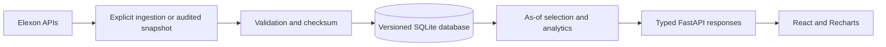

# WindLens

**Day-Ahead Wind Procurement Intelligence**

WindLens reconstructs the wind forecast available when a procurement decision had to be made, measures its historical error, and shows empirical downside exposure. It uses only Elexon FUELHH WIND actuals and WINDFOR forecasts.

**Live app:** [gdscokbirl.vercel.app](https://gdscokbirl.vercel.app/) · **API docs:** [interactive contract](https://gdscokbirl.vercel.app/api/docs) · **CI:** [application checks](https://github.com/adityaapraveen/gdscokbirl/actions/workflows/ci.yml)


## Technology stack

- **Frontend:** React 19, TypeScript, Vite 6 and Recharts. React manages the four analytical views and replay controls; Recharts renders the forecast, error and revision charts.
- **Backend:** Python 3.12, FastAPI, Pydantic and SQLAlchemy. The API owns forecast selection, calibration and metrics, and validates its request and response contracts.
- **Data:** versioned SQLite records and a checksum-verified Elexon snapshot. The fixed historical dataset makes the demo reproducible without credentials or live API calls.
- **Delivery:** Docker Compose for local use, Vercel for the public application, and GitHub Actions for Python tests and the frontend production build.

The frontend is a React single-page application built with Vite. It calls the Python API over HTTP; analytical calculations stay in the backend so every view uses the same rules.

## Start with Docker

Requires Docker Engine with the Compose plugin, or Docker Desktop.

```sh
git clone https://github.com/adityaapraveen/gdscokbirl.git
cd gdscokbirl
docker compose up --build
```

Open [localhost:8080](http://localhost:8080); API documentation is at [localhost:8080/api/docs](http://localhost:8080/api/docs). The backend imports the verified snapshot into a named SQLite volume before serving requests. No Elexon account, API key, external database or live download is needed. Both containers run as non-root users. Only the frontend proxy has a host port, bound to `127.0.0.1`.

`docker compose down` stops the application and preserves the database. Repeated startup does not duplicate records or silently overwrite conflicting values.

## Product walkthrough

- **Overview:** delivery date and configurable D-1 cutoff; source forecast; historical errors; empirical range; downside exposure; revision stability; deterministic procurement brief; decision trace.
- **Accuracy:** retrospective MAE, RMSE, bias and P90 absolute error; forecast/actual series; scatter with ideal reference; histogram; error by delivery time and lead time; chronological interval coverage.
- **Forecast Evolution:** native delivery-hour selector; publication ledger; selected vintage; decision cutoff; replay that reveals actuals and later publications on request.
- **Data Quality:** dynamic row counts, missing periods, native join coverage, resolution mismatch, source timestamps, ingestion metadata and provenance.

Start with **22 January 2026, 09:20 D-1**. Explore evolution at **18:00**, reveal the outcome and reset replay. Try **2 January** to see the insufficient-history state. The cutoff is an explicit application assumption, not a universal UK market deadline.

## Decision-time methodology

Select the latest forecast with `publishTime <= decision_cutoff` for each delivery timestamp. No eligible forecast means unavailable; never substitute a later version.

Uncertainty has a second leakage risk: historical outcomes must also have been published by the replay cutoff. Calibration uses only complete earlier delivery days with visible actuals. Both actual and forecast publication versions are preserved.

The challenge specifies **January decision dates**. Decisions on **1–31 January** cover delivery on **2 January–1 February 2026**. Comparisons and storage use UTC. Cutoffs use London calendar dates, with display in Europe/London.

## Resolution and units

For the full January decision window at the default **09:20 London cutoff**, the bundled data provides **hourly WINDFOR samples** and **half-hour FUELHH averages**: 1,488 actual half-hours and 744 native forecast/actual pairs. Other :30 timestamps are a resolution mismatch, not missing actuals. Headline accuracy uses native timestamps. No interpolated value is presented as a source forecast.

Matching an hourly forecast sample to the half-hour actual average at the same start timestamp is an explicit approximation. All calculations use MW; selected displays convert to GW. The daily headline is mean native forecast power, not energy. No sum of MW is labeled MWh.

## Errors and uncertainty

`error = actual − forecast`: a negative error means less realised wind than forecast.

- **MAE:** mean absolute error.
- **RMSE:** square root of mean squared error; larger misses have more influence.
- **Bias:** mean signed error.
- **P90 absolute error:** 90th percentile of absolute misses.

Empirical lower, median and upper estimates add signed-error P10/P50/P90 to the source forecast and floor wind estimates at zero. Quantiles use linear interpolation at `(n−1) × p`. Calibration requires **seven complete days and 30 matched observations**. These are declared engineering guardrails, not statistical guarantees. The provider's point forecast remains unchanged.

Downside exposure is `max(0, forecast − lower estimate)`. It informs procurement sizing; it is not a buy recommendation. Demand, positions, prices and risk appetite are unavailable. Marginal period quantiles are never summed into a daily portfolio quantile. Ties are disclosed: pooled residuals cannot justify an invented ranking of conditional uncertainty.

Stability compares mean absolute latest revision against prior complete-day revision magnitudes using 33rd/67th percentile boundaries after seven days. It describes revisions, not an accuracy confidence probability.

The [research report](docs/RESEARCH.md) compares pooled residuals with lead-time cohorts. Pooled ranges performed better on the common exploratory sample, so the simpler baseline is retained. Research compares 532 common evaluations; the application's pooled-only backtest has 552 because it does not require populated lead-time cohorts. Neither is independent out-of-month validation.

## Architecture



Elexon downloads and data refreshes are explicit ingestion operations. Records are validated before an atomic import. Identical duplicates are counted; conflicting natural keys reject the batch. Keys include delivery and publication time. An immutable, publication-indexed in-process dataset caches repeated reads. Restart the API after explicitly importing changed data.

A request validates dates and cutoff, selects eligible vintages, joins native actuals where appropriate, calculates results and serializes a typed response. The browser formats and renders values. Routes and chart components do not contain business calculations. Replay responses omit actual outcomes and future forecast values until reveal.

SQLite suits this small, fixed pilot. Docker persists it in a volume. On the first dataset request in a Vercel instance, the backend atomically materialises a checksum-named database in `/tmp` from the bundled snapshot: a disposable cache, not authoritative storage. Cold starts make no Elexon request. SQLAlchemy can use PostgreSQL with `DATABASE_URL` and psycopg, but that deployment mode is not integration-tested. Ongoing ingestion, multiple writers or a larger history would justify managed PostgreSQL.

## Project structure

- `backend/app/main.py`: HTTP validation, routes, request IDs, liveness and readiness.
- `backend/app/sources.py`, `backend/app/elexon.py`, `backend/app/ingest.py`: source contracts, bounded client and explicit import.
- `backend/app/storage.py`, `backend/app/repository.py`: versioned persistence, reads and serverless adapter.
- `backend/app/analytics.py`, `backend/app/services.py`, `backend/app/schemas.py`: temporal logic, metrics, calibration, view composition and response contracts.
- `backend/data/`: compressed real-source snapshot and SHA-256 checksum.
- `backend/tests/`: analytics, leakage, ingestion, API and serverless checks.
- `frontend/src/`: React shell, four pages, charts, API types/client and responsive styling.
- `scripts/`: source audit, residual benchmark and snapshot packaging.
- `tests/`: original research integrity checks.
- `docs/`: research evidence, screenshots and verification notes.
- `docker-compose.yml`, Dockerfiles, `frontend/nginx.conf`: local application.
- `api/index.py`, `vercel.json`: same-origin Vercel deployment.
- `.github/workflows/ci.yml`: tests and frontend build on pushes and PRs.

## Run manually

Use Python 3.12 and Node 22. From the repository root:

```sh
python3.12 -m venv .venv
.venv/bin/pip install -r backend/requirements.lock
.venv/bin/python -m backend.app.ingest
.venv/bin/python -m uvicorn backend.app.main:app --reload --host 127.0.0.1 --port 8000
```

In a second terminal:

```sh
npm ci --prefix frontend
npm --prefix frontend run dev
```

Open [localhost:5173](http://localhost:5173); Vite proxies the API to port 8000. The local API contract is at [localhost:8000/api/docs](http://localhost:8000/api/docs).

`.env.example` documents optional settings. Export backend variables such as `DATABASE_URL` in your shell: the backend does not automatically load `.env`. If the frontend needs a separately hosted API, set `VITE_API_BASE_URL` in `frontend/.env.local` and restart Vite. Default local, Docker and Vercel setups need no overrides.

## Ingestion and reproducibility

Dashboard requests flow from React to FastAPI, which reads the cached dataset loaded from SQLite. The deployed app uses real Elexon responses captured in the bundled snapshot. External Elexon calls happen during explicit source acquisition, through the ingestion command below or the research audit.

```sh
# Verified bundled snapshot, no network
.venv/bin/python -m backend.app.ingest

# Explicit Elexon refresh
.venv/bin/python -m backend.app.ingest --live

# Research audit: downloads source responses into .cache/elexon/
python3 scripts/inspect_elexon.py

# Offline research steps: require the audit download cache above
python3 -m scripts.benchmark_residuals
python3 scripts/build_snapshot.py
```

`--live` fetches the fixed historical challenge window from the FUELHH and WINDFOR endpoints into the configured database. Restart the API to load refreshed records. Updating the Vercel dataset requires rebuilding the bundled snapshot from audited downloads and redeploying; local ingestion alone does not update the public app.

The client uses bounded timeouts and limited retries for network failures, 429 and transient server errors. Permanent 4xx errors are not retried. Null/invalid generation never becomes zero. Live ingestion does not replace the committed snapshot automatically. Rebuilding the snapshot requires checksum-matching research downloads in ignored `.cache/elexon/`. The [audit](docs/elexon-audit.json) records URLs, retrieval times and hashes. Root `requirements.txt` pins runtime dependencies; `backend/requirements.lock` also includes development/test dependencies.

## API

- `GET /api/overview?delivery_date=2026-01-22&cutoff=09:20&reveal=false`
- `GET /api/evolution?delivery_time=2026-01-22T18:00:00Z&cutoff=09:20&reveal=false`
- `GET /api/accuracy?date_from=2026-01-01&date_to=2026-01-31&cutoff=09:20` — decision dates.
- `GET /api/data-quality?cutoff=09:20`
- `GET /health` — process liveness; `GET /ready` — usable dataset.
- `GET /api/docs` — typed interactive contract.

The API is read-only; ingestion is not publicly exposed. CORS defaults to development origins; production frontend and API share an origin. Secrets belong in environment variables and are not committed.

## Testing

After installing both sets of dependencies with the manual setup commands:

```sh
.venv/bin/python -m pytest -q
npm run build
```

Checks cover cutoff equality/future exclusion, timezones/DST, errors, quantiles, missing data, source validation, idempotency, rollback, actual revisions, replay payloads, real-data agreement and serverless reconstruction. GitHub Actions runs both commands on pushes and pull requests.

The [29 October 2026 verification record](docs/VERIFICATION.md) reports **41 passing tests**, a successful TypeScript/Vite production build, Docker startup and browser checks against the public deployment. At the default 09:20 London cutoff across all January decision dates, the 744 matched observations produce **MAE 2,022.47 MW** and **bias −1,745.94 MW**. These are retrospective results for this dataset and cutoff, not a claim of future performance. The record separates local, container, browser and production evidence.

## Data sources and limitations

[FUELHH](https://bmrs.elexon.co.uk/api-documentation/endpoint/datasets/FUELHH/stream) · [WINDFOR](https://bmrs.elexon.co.uk/api-documentation/endpoint/datasets/WINDFOR/stream)

Coverage is GB operationally metered wind, not every UK wind farm or all renewables. Realised output includes effects these datasets cannot isolate, so error is not solely meteorological model error. Source publication time is a proxy for availability; the API cannot prove a trader's receipt time or recover revisions no longer exposed. Adjacent wind errors are correlated. One month cannot establish year-round reliability. No demand, weather, price or trading model is added.

## Deployment

The repository is linked to the Vercel project serving the public app. `vercel.json` builds the React frontend into `frontend/dist` and routes API, health and readiness requests to the Python entry point in `api/index.py`. The browser and API share the same origin. Root `requirements.txt` supplies the serverless Python dependencies.

From an authenticated Vercel account with access to the project, deploy with `npx vercel deploy --prod`, or use Vercel's Git integration. The bundled public-source snapshot makes the demo independent of Elexon availability.

Further analytical work should begin with more historical and out-of-month validation before introducing a conditional uncertainty model or additional infrastructure.

## AI assistance

AI-assisted tools were used for research synthesis, implementation, debugging and review. Sources, analytical assumptions, tests, provenance and limitations are included for independent inspection. AI assistance does not establish analytical correctness; the implementation should be assessed against those sources and checks.
