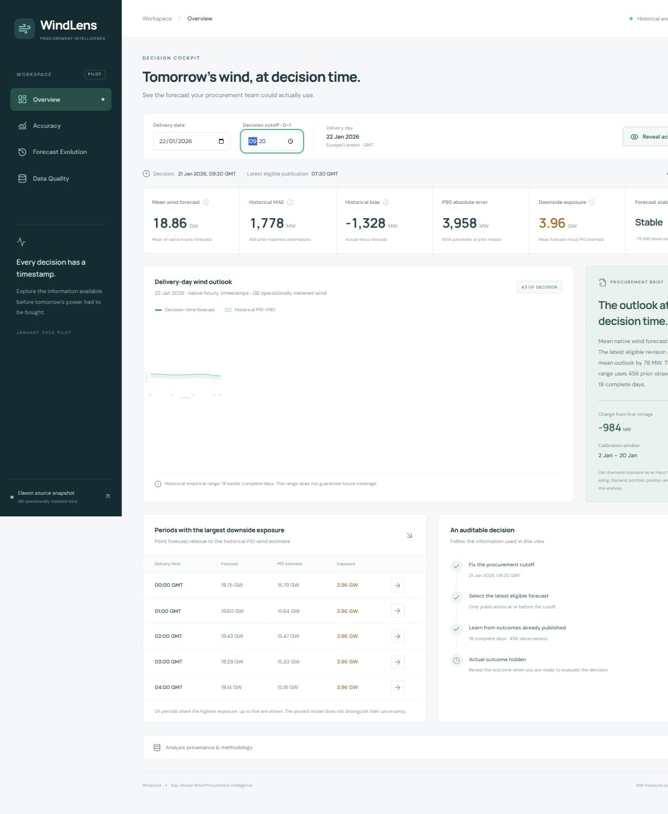
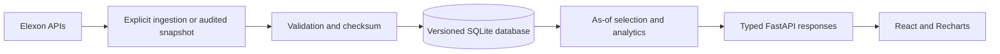

# WindLens

**Day-Ahead Wind Procurement Intelligence**

WindLens reconstructs the wind forecast available when a procurement decision had to be made, measures its historical error, and shows empirical downside exposure. It uses only Elexon FUELHH WIND actuals and WINDFOR forecasts.

**Live app:** [gdscokbirl.vercel.app](https://gdscokbirl.vercel.app) · **API contract:** [interactive documentation](https://gdscokbirl.vercel.app/api/docs)

**Video:** The candidate recording is outstanding. A [timed recording guide](docs/DEMO.md) is included. Do not submit the challenge without its required unlisted video.



## Start with Docker

```sh
git clone https://github.com/adityaapraveen/gdscokbirl.git
cd gdscokbirl
docker compose up --build
```

Open [localhost:8080](http://localhost:8080). The backend imports a checksum-verified source snapshot into a named SQLite volume before serving requests. No Elexon account, API key, external database or live download is needed. Both containers run as non-root users. Only the frontend proxy has a host port.

`docker compose down` stops the application and preserves the database. Repeated startup does not duplicate records or silently overwrite conflicting values.

## Product walkthrough

- **Overview:** delivery date and configurable D-1 cutoff; source forecast; historical errors; empirical range; downside exposure; revision stability; deterministic procurement brief; decision trace.
- **Accuracy:** retrospective MAE, RMSE, bias and P90 absolute error; forecast/actual series; scatter with ideal reference; histogram; error by delivery time and lead time; chronological interval coverage.
- **Forecast Evolution:** native delivery-hour selector; publication ledger; selected vintage; decision cutoff; replay that reveals actuals and later publications on request.
- **Data Quality:** dynamic row counts, missing periods, native join coverage, resolution mismatch, source timestamps, ingestion metadata and provenance.

Start with **22 January 2026, 09:20 D-1**. Explore evolution at **18:00**, reveal the outcome and reset replay. Try **2 January** to see the insufficient-history state. The cutoff is an explicit application assumption, not a universal UK market deadline.

## Decision-time methodology

Select the latest forecast with `publishTime <= decision_cutoff` for each delivery timestamp. No eligible forecast means unavailable; never substitute a later version.

Uncertainty has a second leakage risk: historical outcomes must also have been published by the replay cutoff. Calibration uses only complete earlier delivery days with visible actuals. Both actual and forecast publication versions are preserved.

The challenge specifies **January decision dates**. Decisions on **1–31 January** cover delivery on **2 January–1 February 2026**. Comparisons and storage use UTC. Cutoffs use London calendar dates, with display in Europe/London.

## Resolution and units

Inspection found **hourly WINDFOR samples** and **half-hour FUELHH averages**: 1,488 actual half-hours and 744 native forecast/actual pairs. Other :30 timestamps are a resolution mismatch, not missing actuals. Headline accuracy uses native timestamps. No interpolated value is presented as a source forecast.

Matching an hourly forecast sample to the half-hour actual average at the same start timestamp is an explicit approximation. All calculations use MW; selected displays convert to GW. The daily headline is mean native forecast power, not energy. No sum of MW is labeled MWh.

## Errors and uncertainty

`error = actual − forecast`: a negative error means less realised wind than forecast.

- **MAE:** mean absolute error.
- **RMSE:** square root of mean squared error; larger misses have more influence.
- **Bias:** mean signed error.
- **P90 absolute error:** 90th percentile of absolute misses.

Empirical lower, median and upper estimates add signed-error P10/P50/P90 to the source forecast and floor wind estimates at zero. Quantiles use linear interpolation at `(n−1) × p`. Calibration requires **seven complete days and 30 matched observations**. These are declared engineering guardrails, not statistical guarantees. The provider's point forecast remains unchanged.

Downside exposure is `max(0, forecast − lower estimate)`. It informs procurement sizing; it is not a buy recommendation. Demand, positions, prices and risk appetite are unavailable. Marginal period quantiles are never summed into a daily portfolio quantile. Ties are disclosed: pooled residuals cannot justify an invented ranking of conditional uncertainty.

Stability compares mean absolute latest revision against prior complete-day revision magnitudes using 33rd/67th percentile boundaries after seven days. It describes revisions, not an accuracy confidence probability.

The [research report](docs/RESEARCH.md) compares pooled residuals with lead-time cohorts. Pooled ranges performed better on the common exploratory sample, so the simpler baseline is retained. Research compares 532 common evaluations; the application's pooled-only backtest has 552 because it does not require populated lead-time cohorts. Neither is independent out-of-month validation.

## Architecture



Ingestion is separate from requests. Records are validated before an atomic import. Identical duplicates are counted; conflicting natural keys reject the batch. Keys include delivery and publication time. An immutable, publication-indexed in-process dataset caches repeated reads. Restart the API after explicitly importing changed data.

A request validates dates and cutoff, selects eligible vintages, joins native actuals where appropriate, calculates results and serializes a typed response. The browser formats and renders values. Routes and chart components do not contain business calculations. Replay responses omit actual outcomes and future forecast values until reveal.

SQLite suits this small, fixed pilot. Docker persists it in a volume. Vercel atomically materialises a checksum-named database in `/tmp` from the bundled snapshot: a disposable cache, not authoritative storage. Cold starts make no Elexon request. SQLAlchemy can use PostgreSQL with `DATABASE_URL` and psycopg, but that deployment mode is not integration-tested. Ongoing ingestion, multiple writers or a larger history would justify managed PostgreSQL.

## Project structure

- `backend/app/main.py`: HTTP validation, routes, request IDs, liveness and readiness.
- `sources.py`, `elexon.py`, `ingest.py`: source contracts, bounded client and explicit import.
- `storage.py`, `repository.py`: versioned persistence, reads and serverless adapter.
- `analytics.py`, `services.py`, `schemas.py`: temporal logic, metrics, calibration, view composition and response contracts.
- `backend/data/`: compressed real-source snapshot and SHA-256 checksum.
- `backend/tests/`: analytics, leakage, ingestion, API and serverless checks.
- `frontend/src/`: React shell, four pages, charts, API types/client and responsive styling.
- `scripts/`: source audit, residual benchmark and snapshot packaging.
- `tests/`: original research integrity checks.
- `docs/`: research evidence, screenshots, verification and recording guide.
- `docker-compose.yml`, Dockerfiles, `frontend/nginx.conf`: local application.
- `api/index.py`, `vercel.json`: same-origin Vercel deployment.
- `.github/workflows/ci.yml`: tests and frontend build on pushes and PRs.

## Run manually

Use Python 3.12 and Node 22. From repository root:

```sh
python3 -m venv .venv
.venv/bin/pip install -r backend/requirements.lock
.venv/bin/python -m backend.app.ingest
.venv/bin/python -m uvicorn backend.app.main:app --reload --host 127.0.0.1 --port 8000
```

In a second terminal:

```sh
npm ci --prefix frontend
npm --prefix frontend run dev
```

Open [localhost:5173](http://localhost:5173); Vite proxies the API to port 8000. `.env.example` documents optional settings. Export backend variables in your shell: the backend does not automatically load `.env`. Vite supports its normal frontend environment files. No overrides are needed by default.

## Ingestion and reproducibility

```sh
# Verified bundled snapshot, no network
.venv/bin/python -m backend.app.ingest

# Explicit Elexon refresh
.venv/bin/python -m backend.app.ingest --live

# Research audit, offline benchmark, snapshot packaging
python3 scripts/inspect_elexon.py
python3 -m scripts.benchmark_residuals
python3 scripts/build_snapshot.py
```

The client uses bounded timeouts and limited retries for network failures, 429 and transient server errors. Permanent 4xx errors are not retried. Null/invalid generation never becomes zero. Live ingestion does not replace the committed snapshot automatically. Rebuilding the snapshot requires checksum-matching research downloads in ignored `.cache/elexon/`. The [audit](docs/elexon-audit.json) records URLs, retrieval times and hashes. Root `requirements.txt` pins runtime dependencies; `backend/requirements.lock` also includes development/test dependencies.

## API

- `GET /api/overview?delivery_date=2026-01-22&cutoff=09:20&reveal=false`
- `GET /api/evolution?delivery_time=2026-01-22T18:00:00Z&cutoff=09:20&reveal=false`
- `GET /api/accuracy?date_from=2026-01-01&date_to=2026-01-31&cutoff=09:20` — decision dates.
- `GET /api/data-quality?cutoff=09:20`
- `GET /health` — process liveness; `GET /ready` — usable dataset.
- `GET /api/docs` — typed interactive contract.

The API is read-only; ingestion is not publicly exposed. CORS defaults to development origins; production frontend and API share an origin. Secrets belong in environment variables and are not committed.

## Testing

```sh
.venv/bin/python -m pytest -q
npm run build
```

Checks cover cutoff equality/future exclusion, timezones/DST, errors, quantiles, missing data, source validation, idempotency, rollback, actual revisions, replay payloads, real-data agreement and serverless reconstruction. See [verification notes](docs/VERIFICATION.md) for local, browser, Docker and production evidence.

## Data sources and limitations

[FUELHH](https://bmrs.elexon.co.uk/api-documentation/endpoint/datasets/FUELHH/stream) · [WINDFOR](https://bmrs.elexon.co.uk/api-documentation/endpoint/datasets/WINDFOR/stream)

Coverage is GB operationally metered wind, not every UK wind farm or all renewables. Realised output includes effects these datasets cannot isolate, so error is not solely meteorological model error. Source publication time is a proxy for availability; the API cannot prove a trader's receipt time or recover revisions no longer exposed. Adjacent wind errors are correlated. One month cannot establish year-round reliability. No demand, weather, price or trading model is added.

## Deployment and submission

The repo is linked to the candidate's Vercel project. Deploy with the committed configuration and `npx vercel deploy --prod`, or Vercel's Git integration. The bundled public-source snapshot makes the demo independent of Elexon availability.

Record and upload the candidate's two-part unlisted demo, add its real URL above, and verify app/repo/video in a private browser session before submission. No hiring form has been submitted. Future work should add more historical validation before a conditional uncertainty model or additional infrastructure.

## AI assistance

AI-assisted tools were used for research synthesis, implementation, debugging and review. Sources, analytical assumptions, tests, provenance and limitations are included for independent inspection. The candidate should review the implementation and explain its decisions in their own words before submission.
